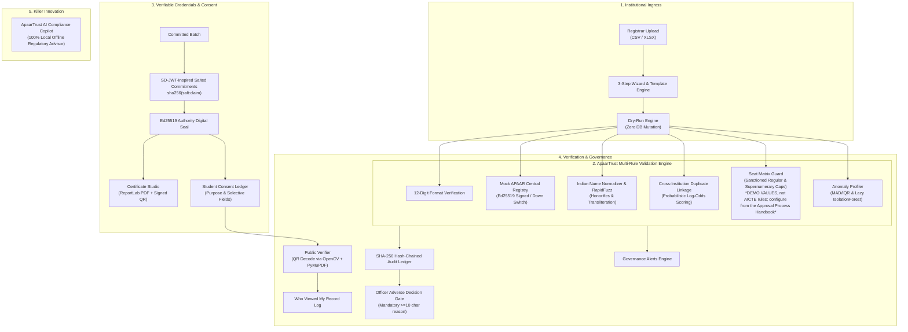

# ApaarTrust 🎓🛡️
> **"One ID. Verified students. Zero exposure."**  
> *Development of an APAAR ID-Based Student Data Management and Verification Platform for AICTE-Approved Institutions*

[](https://python.org)
[](https://fastapi.tiangolo.com)
[](backend/tests/)
[](#)
[](#)

---

## 🏛️ Executive Summary & Positioning

**ApaarTrust** is an assistive, privacy-preserving regulatory management and verifiable credential platform developed for the AICTE problem statement: **"Development of an APAAR ID-Based Student Data Management and Verification Platform for AICTE-Approved Institutions"**.

### Core Guiding Principles:
1. **"One ID. Verified students. Zero exposure."**: Designed with DPDP consent principles in mind; not a legal compliance claim. Students hold sovereign control over their credentials. Verifiers receive mathematical proofs of genuine enrolment without acquiring unnecessary sensitive demographic attributes.
2. **AI Only Advises; Officers Decide**: No automated process or AI model can take an adverse regulatory action (e.g. holding or rejecting a college submission or flagging an institution). Adverse actions strictly require an authenticated Scrutiny Officer, a written justification (minimum 10 characters), and are permanently recorded in an append-only cryptographic audit chain.
3. **Clearly Labelled Mock Registry & Synthetic Data**: All demonstration citizens and institutions are 100% synthetic. Production access would require formal authorization and a security review; we have not assessed those requirements. The mock REST contract is documented in [backend/app/adapters/apaar_registry.py](backend/app/adapters/apaar_registry.py).

---

## 👨‍⚖️ For Judges & Evaluators

Welcome to the **ApaarTrust** evaluation guide.

### 🌐 Live Deployment & Access Options
- **Live URL**: `https://apaartrust-api.snapdeploy.dev` (or Render / GitHub Pages / localtunnel)
- **Zero-Server Preview Mode**: If the host is sleeping or offline, click **"View preview without server"** on the landing page or wake-up modal. ApaarTrust loads instantly using pre-recorded deterministic fixtures with zero server dependency.
- **Local Instant Run**: `python run.py` (binds to `http://127.0.0.1:8080` and opens browser automatically).

### 💤 Free Host Sleep Behaviour
- This prototype is hosted on free-tier container infrastructure (SnapDeploy / Render: 100 free hours/month).
- **Sleep Policy**: The container automatically sleeps after **15 minutes of inactivity** to conserve hours.
- **Waking Up**: Visiting the site or clicking **"Wake the server"** triggers a container wake-up. Spin-up typically takes **30–60 seconds**.
- **In-App Client Safeguard**: The client uses the Page Visibility API and activity monitors to halt background API traffic when hidden or idle > 5 minutes. After 10 minutes idle, a calm banner *"Paused to save free server hours. Resume"* appears and halts all network requests until clicked.
- **Probe Limit**: Wake-up probing automatically stops after 5 minutes with a clean *"Try again"* button and instant option to view the no-server preview.

### 🔍 Preview Mode vs Live Mode
- **Persistent Ribbon**: When preview mode is active, an amber ribbon at the top clearly indicates:  
  `Preview mode: recorded sample data, not the live server` with a `Try the live server` button.
- **Deterministic Samples**: All five personas (Officer, College Registrar, Student, Verifier, Assistant) browse pre-recorded GET responses across 37 realistic fixtures.
- **Mutation Safety**: Mutating actions (uploads, unmasking reveals, triage decisions, consent revocations) display a friendly toast:  
  *"Preview mode: start the live server to try this"*.
- **Offline Assistant**: The AI Compliance Assistant answers questions client-side from the bundled knowledge base (`knowledge_base.yaml`), or displays *"The assistant needs the live server"* with suggested topics.
- **Verifier Outcomes**: All 5 cryptographic verification outcomes (`Genuine`, `Revoked`, `Expired`, `Tampered`, `Not Found`) can be tested directly from recorded results.

### 🎬 Video Walkthrough Placeholder & Script
- **Configurable Video Slot**: A 16:9 demo video slot is embedded on the landing page (configured via `VIDEO_URL` in `frontend/config.js`). When unset, a stable placeholder is shown.
- **Walkthrough Script**: A detailed 3-minute scripted tour with exact click instructions is published at [docs/DEMO_SCRIPT.md](docs/DEMO_SCRIPT.md).

### ⚖️ Honest Platform Limits & Boundaries
1. **DEMO Seat Matrix Values**: Seat caps and supernumerary quotas (TFW 5%, EWS 10%, KM, NRI) are DEMO VALUES for software validation, not statutory AICTE rules. In production, configure directly from the AICTE Approval Process Handbook.
2. **AI Only Advises; Human Decides**: The AI Compliance Assistant provides assistive explanations grounded in YAML rules. AI cannot legally alter regulatory status; adverse actions strictly require human officer authorization and a written justification.
3. **Synthetic Archetype Data**: All institutions (Aryabhata, Bhaskara, Chanakya, Dronacharya, Eklavya) and student records are 100% synthetic. Zero real student PII is included.
4. **Mock Central Registry**: The APAAR Central Registry adapter interfaces with a high-fidelity local mock engine. Production deployments would connect via Government API Setu.
5. **SD-JWT Format**: The selective disclosure format is inspired by the IETF SD-JWT draft specification, optimized for educational credential presentation.
6. **Accessibility**: Targeted towards WCAG 2.2 AA design goals with full keyboard operability, skip links, and high-contrast color tokens.

---

## 🏗️ System Architecture



---

## 📋 Problem Statement Requirement Traceability

| PS Req # | AICTE Validation Requirement | ApaarTrust Technical Implementation | Verified In Tests / Code |
| :--- | :--- | :--- | :--- |
| **Req 1** | 12-digit APAAR format verification & masking | `mask_apaar()` formats as `XXXX-XXXX-1234`; Fernet (AES-128-CBC with HMAC-SHA256) encrypted at rest; HMAC-SHA256 pseudonymous tokens | `test_masking_and_reveal_audit_logging` |
| **Req 2** | Central Registry Resolution with down-switch | Mock APAAR central node signing all responses with Ed25519; returns `cannot_assess` if offline | [backend/app/mock_registry/router.py](backend/app/mock_registry/router.py) |
| **Req 3** | Cross-institution concurrent enrolment detection | Probabilistic log-odds scoring with blocking keys (HMAC token, phonetic DOB); tenure overlap check | `test_cross_institution_duplicate_privacy_redaction` |
| **Req 4** | Privacy preservation between colleges | Redaction engine replaces competing college name with non-prejudicial AICTE notice for Institution role | `redact_finding_for_role(finding, Role.INSTITUTION)` |
| **Req 5** | AICTE Approved Intake Compliance | Sanctioned regular intake ceiling check; live capacity utilization gauges *(DEMO VALUES, not AICTE rules; configure from the Approval Process Handbook)* | `test_over_intake_detected` |
| **Req 6** | Supernumerary Quota Caps | Evaluates TFW (5%), EWS (10%), KM (3 fixed), PMSSS (2 fixed), and NRI/FN (15%) caps from YAML *(DEMO VALUES, not AICTE rules; configure from the Approval Process Handbook)* | [rules/seat_rules.yaml](rules/seat_rules.yaml) |
| **Req 7** | Statistical Anomaly Profiling | Detects 01-Jan default DOB clustering, NRI/FN spikes, and multivariate outliers (MAD/IQR + IsolationForest) | [backend/app/engine/anomaly.py](backend/app/engine/anomaly.py) |
| **Req 8** | Risk-free Pre-Flight Upload | Dry-Run simulation engine; previews row errors and gauges without modifying database | `test_dry_run_saves_nothing` |
| **Req 9** | Submission Versioning & "What Changed" | Automated delta engine identifying new, resolved, and persistent defects between uploads | [backend/app/engine/diff.py](backend/app/engine/diff.py) |
| **Req 10** | Verifiable Certificate of Enrolment | ReportLab PDF generator rendering sample certificate with APAAR ID, student roll ID, and signed QR verification seal | [backend/app/engine/credentials.py](backend/app/engine/credentials.py) |
| **Req 11** | Zero-Exposure Selective Disclosure | SD-JWT-inspired salted commitments (`sha256(salt:claim)`); students control disclosed fields | `test_selective_disclosure_and_tamper_detection` |
| **Req 12** | Citizen Digital Consent Ledger | Purpose-bound consent grants; revocable by student; blocks verification upon revocation | `test_revoked_consent_blocks_verification` |
| **Req 13** | Verification Access Transparency | Every verification logged with verifier type and disclosed fields in "Who viewed my record" | `GET /api/v1/students/{token}/access-log` |
| **Req 14** | Immutable Regulatory Audit Chain | Cryptographic SHA-256 hash-chained log linking event hashes; interactive tamper-detection demo | `test_audit_chain_tamper_detection` |
| **Req 15** | Offline Local AI Compliance Assistant | BM25 + RapidFuzz matching across YAML rules and 60+ KB entries; live role-scoped query tools; mandatory refusal on out-of-scope | `test_copilot_offline_matching` |

---

## 🎯 Flagship User Journeys

ApaarTrust is designed around five flagship end-to-end user journeys:

### Journey 1: College Admissions & Dry-Run Upload (`#/college/upload`)
- **Download Templates**: 1-click clean CSV/XLSX templates or sample file with 5 deliberate errors.
- **Dry-Run Engine**: Evaluates rosters with zero DB mutation and updates live regular and supernumerary seat gauges.
- **Actionable Error Summary**: GOV.UK style summary linking directly to rows (`#finding-row-X`) with AICTE fix hints.
- **Cryptographic Receipt**: Submitting commits verified students and issues an immutable SHA-256 receipt modal.
- **Certificate Studio**: Issue Sample Certificate PDFs with embedded Ed25519-signed QR seals.

### Journey 2: Central Officer Oversight & Duplicates (`#/officer/overview`)
- **National Scrutiny**: Interactive State Tile Map filters institutions by region and flags over-intake breaches.
- **Bhaskara Intake Investigation**: Highlights CSE 120/90 capacity violation with plain-language reasons.
- **Duplicate Adjudication**: Side-by-side comparison of cross-institution duplicate admissions with logged decision audit.
- **APAAR Unmasking Safeguard**: Revealing full 12-digit number strictly requires an authenticated officer and written justification (min 10 chars).
- **Tamper Simulation & Chain Restoration**: Simulate unauthorized SQL mutation, observe verification failure, and restore chain integrity.
- **Institutional Compliance Report**: Export official ReportLab PDF compliance audit reports with DEMO VALUES notices.

### Journey 3: Student Sovereign Consent & DigiLocker (`#/student/record`)
- **Digital ID Card**: Citizen ID card with national tricolour accent, masked identifier, and verifiable enrolment seal.
- **Selective Disclosure**: Fine-grained consent scoping (disclose programme while withholding sensitive DOB and caste).
- **Presentation Share**: Generate SD-JWT presentation code and QR seal with expiration timestamp.
- **Instant Revocation**: 1-click revocation immediately blocks third-party verification.
- **Access Trail Transparency**: "Who viewed my record" timeline tracks every verification query.

### Journey 4: Public Verifier (`#/verify`)
- **5-Outcome Verification**: Test all five cryptographic outcomes using 1-click credentials:
  1. `Genuine`: Ed25519 signature valid, selective fields verified.
  2. `Revoked`: Student has withdrawn consent; verification rejected.
  3. `Expired`: Presentation timestamp lapsed; next steps displayed.
  4. `Tampered`: Cryptographic hash mismatch; tampering alert shown.
  5. `Not Found`: Safe rejection of invalid identifier.

### Journey 5: AI Compliance Assistant (`#/assistant` & drawer)
- **Always Available**: Prominent floating launcher bottom-right with 10s pulse, topbar trigger (`Ctrl+/`), and full-page view.
- **Strictly Rule-Grounded**: Grounded in YAML rules and 60+ Q&A entries; rejects out-of-scope inquiries with standard refusal.
- **Action Buttons & "Show Me" Spotlight**: Live walkthrough highlights relevant UI controls with animated spotlight rings.
- **Live Role-Scoped Query Tools**: Answers dynamic counts (open findings, enrolled students, active consents) without cross-role leakage.

---

## 📸 Product Interface & Visual Tour

Automated full-page proof screenshots captured at 1440px and 390px viewports via Chrome DevTools Protocol:

| View | Feature Highlights | Verified Proof Screenshot |
| :--- | :--- | :--- |
| **Landing Page & Front Door** | *Sticky navigation, 3-minute quick starts, interactive SVG architecture diagram, and demo persona cards.* | [docs/screenshots/landing_page_1440.png](docs/screenshots/landing_page_1440.png) |
| **AICTE Officer Overview** | *KPI sparklines, Regional State Tile-Grid Map, and Enrolment vs Approved Sanctioned Intake bar chart.* | [docs/screenshots/officer_overview_1440.png](docs/screenshots/officer_overview_1440.png) |
| **Over-Intake & Seat Gauges** | *Animated regular intake gauges and supernumerary caps (TFW, EWS, FN) with DEMO VALUES notices; masked student APAAR IDs.* | [docs/screenshots/college_upload_1440.png](docs/screenshots/college_upload_1440.png) |
| **Cross-Institution Duplicates** | *Probabilistic log-odds scoring with token/DOB match breakdown bars; peer college privacy redaction.* | [docs/screenshots/officer_overview_1440.png](docs/screenshots/officer_overview_1440.png) |
| **College 3-Step Upload Wizard** | *Drag-and-drop CSV/XLSX, zero-commitment dry run, GOV.UK style error summary, and row-level inline fix hints.* | [docs/screenshots/college_upload_1440.png](docs/screenshots/college_upload_1440.png) |
| **Student DigiLocker Digital ID** | *Citizen digital ID card with national tricolour accent, masked identifier, verifiable QR seal, and enrolment status.* | [docs/screenshots/student_record_1440.png](docs/screenshots/student_record_1440.png) |
| **Sovereign Consent Ledger** | *Purpose-bound grants, field-level disclosure toggles, live verifier visibility explainer, and one-click revocation.* | [docs/screenshots/student_record_1440.png](docs/screenshots/student_record_1440.png) |
| **Public Verifier (#/verify)** | *Zero-login document dropzone, QR decoder, live cryptographic evaluation, and disclosed vs withheld attributes panel.* | [docs/screenshots/public_verify_1440.png](docs/screenshots/public_verify_1440.png) |
| **AI Compliance Copilot** | *Grounded in local YAML rules and glossary with citations, role-scoped DB tools, feedback thumbs, and `Ctrl+/` shortcut.* | [docs/screenshots/assistant_1440.png](docs/screenshots/assistant_1440.png) |
| **Mobile Smartphone Reflow** | *Single-column responsive layout at 390px, 44px touch targets, zero horizontal page scroll.* | [docs/screenshots/mobile_390.png](docs/screenshots/mobile_390.png) |

---

## 🧪 Automated Click-Through QA & Quality Audit

ApaarTrust includes an automated headless Chrome test runner (`scripts/run_qa_matrix.mjs`) that connects via the Chrome DevTools Protocol (CDP) to systematically verify every control across 4 viewports:
- **1440px Desktop**
- **1024px Tablet Landscape**
- **768px Tablet Portrait**
- **390px Mobile Smartphone**

**Current Audit Status**:
- **Matrix Checks**: **20/20 Passed (100% Success Rate)**
- **Console Errors**: **0 Errors**
- **Network Failures**: **0 Failures**
- **Pytest Suite**: **21/21 Passed**
- Full test matrix details and verification methodology are published in [docs/QA_REPORT.md](docs/QA_REPORT.md).

---

## 🚀 How to Run Locally

### 1. Prerequisites
- **Tested on Python 3.12**
- Web Browser (Chrome, Firefox, Edge, Safari)

### 2. Launching the Prototype
```bash
# Simply run the startup script
python run.py
```
This automatically:
- Initializes the SQLite database (`data/apaartrust.db`).
- Seeds the 5 canonical archetype institutions (~1,161 students).
- Launches the FastAPI backend at `http://127.0.0.1:8080`.
- Automatically opens your default web browser to the interactive dashboard.

### 3. Running Pytest Test Suite
```bash
# Run the complete 21-test suite
python -m pytest backend/tests/ -v

# Run with low-memory configuration
$env:LOW_MEMORY="1"; python -m pytest backend/tests/ -v
```

### 4. Running Code Quality & Syntax Verification
```bash
# Verify Python syntax and imports with pyflakes
python -m pyflakes backend/ run.py

# Verify all 54 JavaScript modules with node --check
node scripts/check_syntax.mjs

# Verify ES module graph with zero-dependency static analyzer
node scripts/check_frontend.mjs
```

---

## ☁️ 100% Free Cloud Deployment (Zero Cost, No Credit Card)

ApaarTrust includes pre-configured deployment artifacts ([zeabur.json](zeabur.json), [Dockerfile](Dockerfile), [Procfile](Procfile), [.dockerignore](.dockerignore), [requirements-render.txt](requirements-render.txt)) for instant hosting without Render or any paid subscriptions:
- **Zeabur (Top Cloud Recommendation)**: 100% free plan, zero credit card required, connects to GitHub, automatically builds and provisions a free `https://<app>.zeabur.app` domain.
- **Instant Secure Tunnel**: Expose your already-running local prototype worldwide in 5 seconds via `npx localtunnel --port 8080`.
- **SnapDeploy**: Free container hosting for Docker apps with zero credit card.

👉 Follow the step-by-step instructions in [docs/FREE_HOSTING_GUIDE.md](docs/FREE_HOSTING_GUIDE.md).

---

## 📜 License
Apache License 2.0. Developed for the AICTE Problem Statement Prototype Evaluation.

